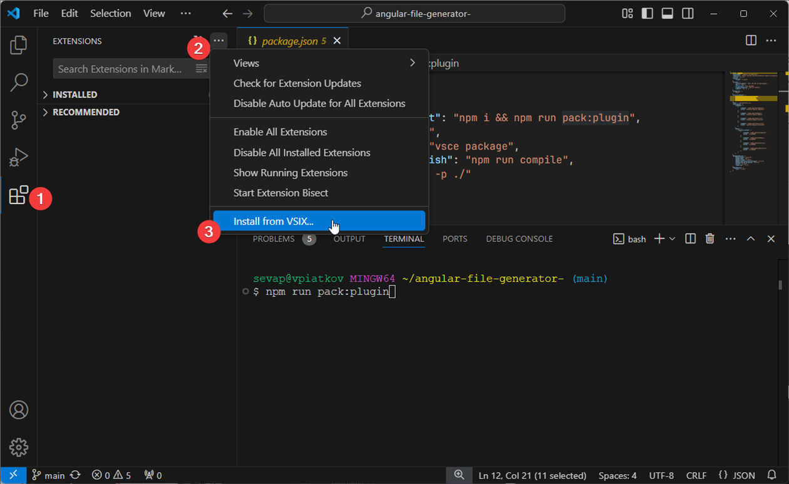
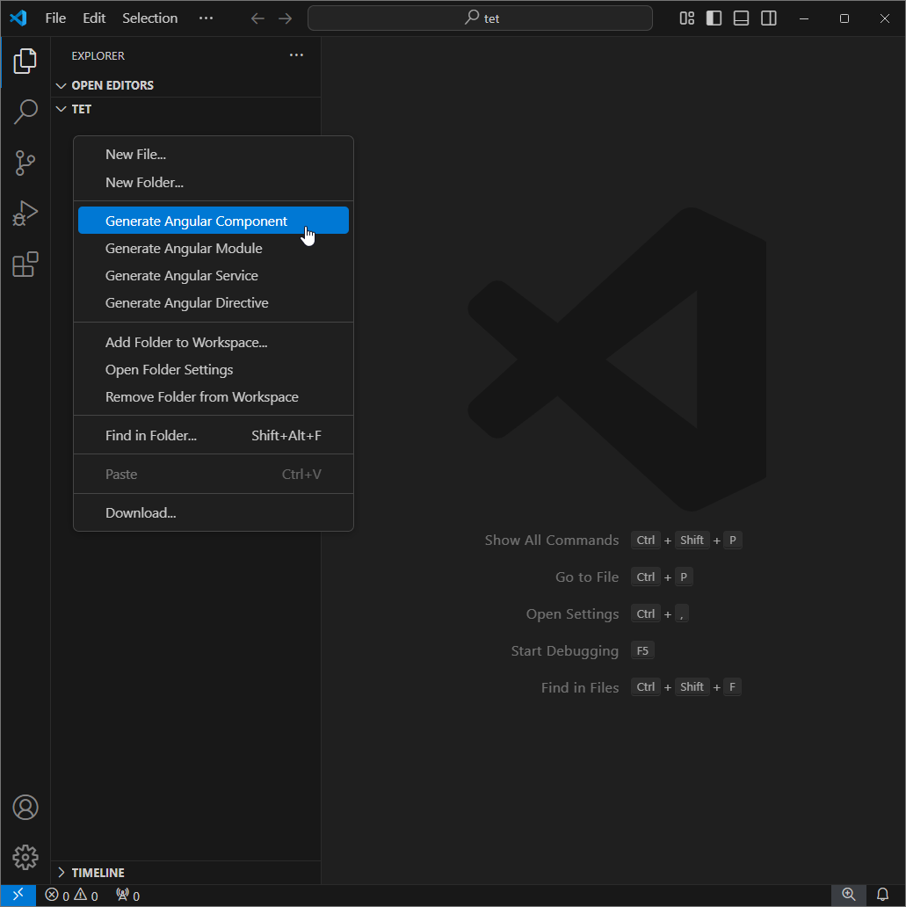
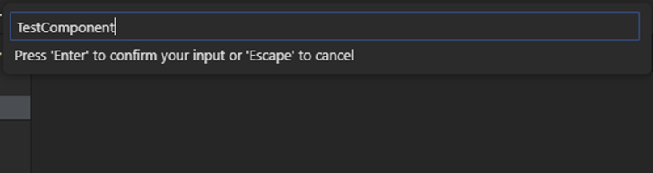
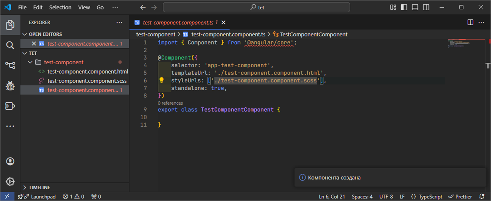

# angular-file-generator

Расширение для VSCode, которое автоматизирует генерацию шаблонного кода Angular компонентов, способствует ускорению разработки и минимизации рутины. Инструмент особенно полезен для разработчиков, активно работающих с Angular, предоставляя готовые шаблоны для компонентов, директив и сервисов.

## Как установить

1) Чтобы установить расширение, необходимо выполнить следующую команду
```
npm run install_project
```
2) После появление файла `angFG-<version>.vsix`выполнить установку через VSIX

3) Расширение установлено

## Как пользоваться

1) В качестве примера создадим компоненту.

2) Вводим ее название.

3) Наслаждаемся результатом


## Планы на будущее

- Возможность создания из шаблонов
- Возможность указать настройки компонент для конкретного проекта
- Дописать код для остальных сущностей
- Попробовать перенести плагин на WebStorm
